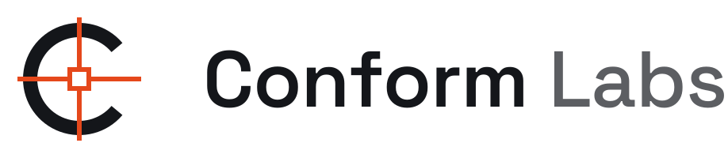

  <picture>
    <source media="(prefers-color-scheme: dark)" srcset="assets/conformlabs-lockup-reversed.svg">
    
  </picture>

Conform Labs builds AI operators for professional editing and post-production software. Each product lets the AI you already use operate a pro app precisely, locally and safely, and proves what it did.

In post-production, the *conform* is the step where the offline edit is rebuilt, frame for frame, against the full-quality media. Nothing is approximated and every cut has to line up. We hold our tools to the same standard.

## Products

**[Surehand MCP for Adobe® After Effects®](https://github.com/ConformLabs/surehand-mcp)**: lets Claude, ChatGPT, Cursor, Codex or any MCP client operate After Effects. Every edit returns a list of exactly what changed in the project, and tools never replace an existing file silently.
